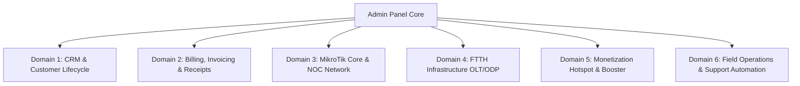

# AUDIRA ULTIMATE ADMIN PANEL ENHANCEMENT MASTER PLAN
**Author:** Agus Dwi Rianto (AUDIRA)  
**Organization:** Audira Multimedia Digital / Audira Sukses Mandiri  
**Standard:** AUDIRA UI/UX Pro Max (`F:\AUDIRA-DESAIN-UI-UX`)  
**Target:** Full Production-Grade Enterprise ISP Admin Experience

---

## 1. Executive Vision & Anti-Slop Directive

All UI/UX and logic across the AUDIRA Admin Panel are upgraded from basic/AI-slop mockups to a high-density, real-world ISP Operations Management suite.

### Non-Negotiable Directives:
1. **Zero AI Slop:** No neon glow rings, no rainbow gradient borders, no floating scanlines, and absolutely **no emojis as UI icons**. All icons must be unified SVGs from `lucide-react`.
2. **Design Tokens & Theme Consistency:**
   - Fonts: Primary **Plus Jakarta Sans**, Monospace (IPs, MACs, Money, Speed, Ports, Timers) **JetBrains Mono**.
   - Colors: Enterprise Deep Navy (`#1E3A5F`), Royal Blue (`#2563EB`), Paid Emerald (`#059669`), Warning Amber (`#D97706`), Overdue Crimson (`#DC2626`), Slate Muted (`#64748B`).
   - Surfaces: Explicit semantic variables (`--app-bg`, `--app-card`, `--app-border`, `--app-text`, `--app-text-muted`, `--app-primary`) providing crisp contrast in both Dark & Light modes.
   - Density: Enterprise Level 8/10 (compact table rows, sharp 1px borders, subtle badges, tabular figures).
3. **Zero Fake Fallback Data:** 
   - Eliminate hardcoded placeholder dates (e.g., `"01 Juli 2026"`) and arbitrary fallback metrics (e.g., `"3.248"`, `"412.500.000"`).
   - All metrics are calculated reactively from live database states or explicitly display real empty states with actionable CTA buttons.
4. **Resilient Production Plumbing:**
   - Unified API error handling, toast notifications with auto-dismiss, loading skeletons, and debounced filter inputs.

---

## 2. Six Functional Domains & Detailed Enhancement Roadmap

---

### Domain 1: CRM & Customer Lifecycle (`pelanggan.tsx`)
- **Key Enhancements:**
  - Real dynamic KPI metric strip computed directly from customer records (Total, Aktif, Isolir/Suspend, Expired, Trial, Pending).
  - Multi-parameter filter engine: Search (Name, Phone, IP, PPPoE username), Status filter, Package filter, Area/ODP filter.
  - Lifecycle Quick Actions:
    - **Isolir / Suspend**: Instant trigger to backend & MikroTik to disable PPPoE active connection and move to isolate pool.
    - **Unblock / Aktifkan**: Restore full bandwidth instantly.
    - **Janji Bayar (Grace Period)**: Extend suspension deadline with note.
    - **Kirim Tagihan WA**: Dispatch billing reminder WhatsApp message via Fonnte.
  - View switch: Compact High-Density Table View vs. Visual Technical Grid View.
  - Data Export: CSV / Excel export and Printable Customer Directory.

---

### Domain 2: Invoicing, Billing & Receipts (`invoice.tsx`, `invoices-admin.tsx`)
- **Key Enhancements:**
  - Completely remove the static `displayInvoices` mock fallback. When database is empty, display a clean, enterprise-grade Empty State with "Generate Tagihan Otomatis" CTA.
  - Live Financial KPIs: Total Tagihan, Terbayar (Paid), Menunggak (Pending), Jatuh Tempo (Overdue) dynamically aggregated.
  - Batch Generator Modal: Generate invoices for all active customers for a selected billing cycle with custom due dates.
  - Payment Modal: Settle invoices via Cash, Bank Transfer, QRIS, or Virtual Account with auto-receipt creation.
  - Thermal 58mm/80mm & A4 PDF Receipt Preview & Print Studio.
  - Integrated WhatsApp Notification: One-click send invoice notification with invoice link and QRIS payload.

---

### Domain 3: Core Network & MikroTik NOC (`mikrotik.tsx`, `noc.tsx`, `modem-monitor.tsx`)
- **Key Enhancements:**
  - High-density Router Matrix: Router identity, IP address, API port (8728/8729), connection state (Active, Error, Connecting).
  - Hardware Diagnostics: Live CPU load, Memory usage, Disk utilization, Uptime, RouterOS version, and Architecture.
  - Real-time Interface Traffic Monitor: Recharts Area Chart displaying RX/TX throughput in JetBrains Mono (`Kbps`, `Mbps`, `Gbps`).
  - Active PPPoE & Hotspot Connections viewer.
  - Quick Tools: Ping Test, Torch Interface, Reboot Routerboard, and Sync Secrets.

---

### Domain 4: FTTH Infrastructure (`infrastruktur/olt.tsx`, `infrastruktur/odp.tsx`)
- **Key Enhancements:**
  - OLT Management: Monitor EPON/GPON OLTs (VSOL, Huawei, ZTE, HIOSO), PON port status, and registered ONUs.
  - Optical Power Telemetry: Red/Yellow/Green badges for ONU optical RX power (e.g. `-18 dBm` to `-24 dBm` Normal, `< -27 dBm` Critical Low).
  - ODP Port Manager: Visualize 1:8 / 1:16 splitter ports, occupied customer drop cables, and remaining core capacity.

---

### Domain 5: Revenue & Monetization Streams (`hotspot.tsx`, `booster.tsx`, `packages-admin.tsx`)
- **Key Enhancements:**
  - Hotspot Voucher Studio:
    - Mass voucher generator (Prefix, Length, Character Set, Price, Profile).
    - Thermal Print Studio with ready-to-cut voucher card layouts featuring QR codes for instant login.
    - Active voucher sessions and revenue counter.
  - Bandwidth Booster:
    - Speed-on-demand turbo packages (+20 Mbps, +50 Mbps) with automatic expiry timer and MikroTik rate-limit sync.
  - Package Management:
    - Clean bandwidth limits (`Rate-Limit` upload/download), burst thresholds, validity period, and pricing.

---

### Domain 6: Field Operations & Support Automation (`kolektor.tsx`, `field-service.tsx`, `tickets.tsx`, `whatsapp.tsx`)
- **Key Enhancements:**
  - Collector Shift Tracker: Open shift, register physical cash collections from home visits, close shift with discrepancy balance audit.
  - Work Order Dispatch (SPK): Installasi Baru, Perbaikan Gangguan, Relokasi Kabel with technician assignment.
  - Trouble Tickets: Priority tracking (P1 Outage, P2 Slow, P3 General) with SLA timer countdown.
  - WhatsApp Gateway: Live Fonnte device session QR code, automatic billing dispatch toggle, template editor.

---

## 3. Implementation Phasing Strategy

| Phase | Modules | Primary Objectives | Status |
| :--- | :--- | :--- | :--- |
| **Phase 1** | `pelanggan.tsx` | Clean metrics, eliminate dummy fallbacks, real filter/search, UI/UX Pro Max tokens | Ready |
| **Phase 2** | `invoice.tsx` | Eliminate mock array, dynamic financial totals, thermal receipt preview, batch modal | Ready |
| **Phase 3** | `mikrotik.tsx` | Professional router board cards, real traffic telemetry, quick diagnostics | Ready |
| **Phase 4** | `hotspot.tsx` & `booster.tsx` | Voucher batch generator, 80mm print card, speed booster on-demand controls | Ready |
| **Phase 5** | `kolektor.tsx` & `infrastruktur/*` | Collector shift cash ledger, OLT optical power matrix, ODP port allocation | Ready |
| **Phase 6** | Build & Verification | TypeScript typecheck (`tsc --noEmit`), Next.js bundle verification, visual check | Ready |
