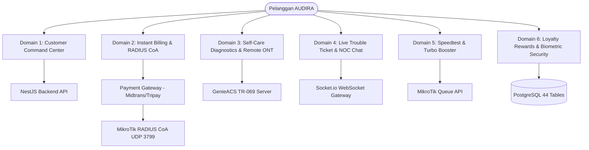

# 🌐 AUDIRA ULTIMATE CUSTOMER (PELANGGAN) EXPERIENCE ENHANCEMENT MASTER PLAN
**Author:** Agus Dwi Rianto (AUDIRA)  
**Organization:** Audira Multimedia Digital / Audira Sukses Mandiri  
**Official Portal:** [https://audira.my.id](https://audira.my.id)  
**Standard:** AUDIRA UI/UX Pro Max (`F:\AUDIRA-DESAIN-UI-UX`) & Neo-Brutalism Cyberpunk Design System  
**Target:** Production-Grade ISP Customer Self-Care Suite (Mobile App & Web Portal)  
**Version:** 1.0.0 (Production Blueprint)

---

## 1. 🎓 Conceptual Masterclass: Executive Vision & Anti-Slop Directive

Pelanggan adalah pusat perputaran roda bisnis ISP. Sistem *Customer Self-Care* tradisional pada ISP konvensional seringkali lambat, kaku, dan membebani tim NOC dengan tiket berulang untuk masalah sepele (lupa kata sandi WiFi, modem hang, konfirmasi pembayaran manual).

Melalui **AUDIRA Ultimate Customer Enhancement Plan**, portal pelanggan (Mobile Flutter App `AUDIRA-NET` dan Web Portal `AUDIRA-BILLING`) dinaikkan standarnya dari sekadar aplikasi cek tagihan menjadi **Autonomous Customer Command Center**.

```
┌────────────────────────────────────────────────────────────────────────┐
│                   AUDIRA CUSTOMER AUTONOMOUS HUB                      │
│                                                                        │
│   [ Live Telemetry ]  ──>  [ Self-Care Doctor ]  ──>  [ Remote ONT ]  │
│          │                        │                        │          │
│   [ Instant QRIS ]    ──>  [ RADIUS CoA Unblock] ──>  [ Realtime Chat]│
└────────────────────────────────────────────────────────────────────────┘
```

### Non-Negotiable Directives:
1. **Zero AI Slop & Meaningful Aesthetics:**
   - Desain mengadopsi **Electric Cyan Palette** (`#00F0FF`, `#0080FF`, `#060A14`) khas persona *Pelanggan AUDIRA*.
   - Tidak ada animasi berlebihan yang menghambat *cold-start* aplikasi. Seluruh transisi berjalan lancar di 60 FPS pada perangkat Android entry-level hingga flagship.
   - Penggunaan ikon seragam: FontAwesome / Lucide SVG, tidak ada emoji sembarangan sebagai elemen UI formal.
2. **Zero Fake Fallback Data:**
   - Semua metrik (Sisa Kuota FUP, Kecepatan, Redaman Optik dBm, Status Tagihan, Sisa Hari Aktif) wajib terhubung ke endpoint API riil atau menampilkan *Actionable Empty States*.
   - Tidak ada angka rekayasa (*hardcoded metrics*). Jika pelanggan belum memiliki tagihan, tampilkan ucapan status aman (*"Layanan Prima, Tidak Ada Tunggakan"*).
3. **Autonomous Self-Healing (Dokter Jaringan 1-Tap):**
   - Memberikan pelanggan kendali langsung atas perangkat ONT/Modem di rumah mereka melalui protokol TR-069 GenieACS dan SNMP tanpa perlu menunggu teknisi datang untuk masalah ringan.
4. **Instant Gratification Billing (Bayar Langsung Nyala):**
   - Integrasi Payment Gateway (QRIS & Virtual Account) yang otomatis memicu **RADIUS CoA (Change of Authorization)** dalam tempo < 2 detik. Jika internet terisolir, pembayaran sukses langsung memulihkan koneksi seketika.

---

## 2. 🏛️ Arsitektur Enam Domain Fitur Pelanggan



---

### Domain 1: Customer Command Center (Beranda Pintar & Telemetri)
*Target Berkas:* `lib/screens/customer/tabs/customer_beranda_tab.dart`, `widgets/customer_hero_service_card.dart`

- **Fitur Utama:**
  - **Connection Telemetry Strip:** Status koneksi real-time (`CONNECTED / SUSPENDED / HIGH LATENCY`), Latensi ke Gateway ISP, Alamat IP Publik & Lokal, nama SSID aktif.
  - **Interactive FUP Radial Gauge:** Indikator konsumsi kuota bulanan berbentuk radial gauge dengan zona warna:
    - *Hijau (< 70% kuota)*: Kecepatan maksimal terjamin.
    - *Kuning (70% - 90%)*: Peringatan mendekati batas FUP.
    - *Merah (> 90%)*: Tombol langsung untuk aktivasi Turbo Booster.
  - **Service Overview Carousel:** Detail paket aktif (contoh: *AUDIRA Fiber Home 50 Mbps*), tanggal jatuh tempo, dan hitungan mundur sisa masa aktif.
  - **Proactive Maintenance Card:** Banner otomatis yang muncul jika OLT/ODP di area pelanggan sedang dalam jadwal pemeliharaan jaringan, mencegah komplain panik.

---

### Domain 2: Invoicing, Instant Checkout & RADIUS CoA ("Bayar Langsung Nyala")
*Target Berkas:* `lib/screens/customer/tabs/customer_tagihan_tab.dart`, `screens/customer/payment_page.dart`

- **Fitur Utama:**
  - **Dynamic Invoice Breakdown:** Rincian transparan tagihan bulan berjalan:
    - Biaya Pokok Paket Internet
    - Sewa Perangkat ONT / STB Android
    - Pajak PPN 11%
    - Biaya Transaksi & Diskon Loyalty Points
  - **Multi-Rail Real-Time Checkout:**
    - **QRIS Dinamis**: Tampil langsung dengan hitungan mundur *expired* (15 menit) dan auto-check status setiap 3 detik.
    - **Virtual Account Otomatis**: BCA, Mandiri, BRI, BNI dengan tombol *Salin Nomor VA*.
    - **Gerai Retail**: Kode bayar barcode Indomaret & Alfamart.
  - **Autonomous RADIUS CoA Execution:**
    - Webhook pembayaran langsung memanggil `POST /billing/invoices/:id/pay` -> trigger MikroTik CoA disconnect packet ke NAS IP port 3799.
    - Routerboard merestart session PPPoE pelanggan dari profile `ISOLIR_POOL` kembali ke profile reguler dalam waktu < 2 detik.
  - **E-Receipt & Thermal Print Studio:**
    - Unduh bukti bayar format PDF resmi bertanda tangan digital Agus Dwi Rianto dan QR Code verifikasi.
    - Tombol *Bagikan Struk via WhatsApp*.

---

### Domain 3: Self-Care Diagnostics, TR-069 GenieACS & Remote ONT/WiFi
*Target Berkas:* `lib/screens/customer/wifi_management_page.dart`, `widgets/customer_quick_actions.dart`

- **Fitur Utama:**
  - **Dokter Jaringan 1-Tap (Automated Diagnostic Wizard):**
    - Menjalankan 4 langkah pengujian otomatis:
      1. *Uji Sinyal Optik ONT*: Membaca Optical RX Power (dBm) via TR-069. Kategori: Bagus (`-16` s.d `-23 dBm`), Cukup (`-24` s.d `-26 dBm`), Kritis (`< -27 dBm`).
      2. *Uji Autentikasi PPPoE*: Memverifikasi status login router ke server MikroTik.
      3. *Uji DNS ISP*: Pengujian resolusi domain cepat (`1.1.1.1` & `8.8.8.8`).
      4. *Uji Latensi Gateway*: Ping ke gateway lokal ISP (< 15 ms).
  - **Remote ONT Studio:**
    - **Restart Modem Jarak Jauh**: Kirim instruksi `Reboot` aman via GenieACS API tanpa perlu mencabut kabel adaptor.
    - **Manajemen WiFi Dual-Band**: Ganti nama WiFi (SSID) dan kata sandi untuk frekuensi 2.4 GHz dan 5.0 GHz langsung dari aplikasi.
    - **Daftar Perangkat Terhubung**: Melihat nama HP, Laptop, dan Smart TV yang sedang menggunakan WiFi beserta kekuatan sinyalnya, dilengkapi tombol proteksi pemblokiran perangkat asing.

---

### Domain 4: Live Trouble Ticket & Real-Time NOC Chat
*Target Berkas:* `lib/screens/customer/tabs/customer_bantuan_tab.dart`, `screens/customer/chatbot_page.dart`

- **Fitur Utama:**
  - **Smart Trouble Ticket Intake:**
    - Pilihan kategori: *Internet Mati Total (P1)*, *Internet Lambat (P2)*, *Kendala Fisik/Kabel Putus (P3)*.
    - Upload foto bukti fisik (lampu indikator LOS merah pada modem, kabel tergencet).
    - Status Tracking Bar interaktif: `Tiket Dibuat ➔ Diverifikasi NOC ➔ Teknisi Menuju Lokasi ➔ Proses Perbaikan ➔ Uji Redaman Selesai`.
  - **Two-Way Live Support Chat (WebSocket Socket.io):**
    - Ruang obrolan langsung antara Pelanggan, Tim Helpdesk NOC, dan Teknisi Lapangan yang ditugaskan.
    - Mendukung pengiriman gambar, status terbaca (*read receipts*), dan notifikasi push saat ada balasan.
  - **24/7 AI Smart Bot Assistant:**
    - Penjawab otomatis berbasis FAQ resmi AUDIRA untuk penanganan pertama komplain umum.

---

### Domain 5: Speedtest Lokal & Turbo Bandwidth Booster
*Target Berkas:* `lib/screens/customer/speed_test_page.dart`, `screens/customer/package_upgrade_page.dart`

- **Fitur Utama:**
  - **Speedtest Mandiri Terintegrasi:**
    - Pengujian kecepatan terhubung langsung ke node server lokal BGP / Peering ISP AUDIRA.
    - Menampilkan Ping, Jitter, Download Speed, dan Upload Speed dengan visual speedometer neon cyberpunk.
    - Tombol *Simpan & Kirim Hasil ke NOC* untuk mempermudah validasi teknisi.
  - **Speed-on-Demand Turbo Booster:**
    - Pilihan paket booster instan:
      - *Turbo Gamer 50 Mbps (12 Jam)*
      - *Turbo Streamer 100 Mbps (24 Jam)*
      - *Weekend Blast 100 Mbps (3 Hari)*
    - Aktivasi instan: Mikrotik Simple Queue / PPPoE profile langsung di-update secara otomatis begitu pembayaran add-on terkonfirmasi.
    - Tampilan *Countdown Timer* aktif di beranda pelanggan.

---

### Domain 6: AUDIRA Loyalty Points & Biometric Security
*Target Berkas:* `lib/screens/customer/tabs/customer_profil_tab.dart`, `screens/customer/loyalty_rewards_page.dart`

- **Fitur Utama:**
  - **AUDIRA Loyalty Points Engine:**
    - Poin otomatis bertambah setiap kali membayar tagihan tepat waktu sebelum tanggal 20.
    - Katalog penukaran poin: Diskon tagihan bulan berikutnya (Voucher Rp 10.000, Rp 25.000, Rp 50.000) atau gratis kuota Turbo Booster.
    - Status Tier: *Silver Member*, *Gold Member*, *Platinum VIP*.
  - **Biometric Authentication (Passkey):**
    - Login cepat menggunakan sensor sidik jari (Fingerprint) atau pengenalan wajah (Face ID).
    - Manajemen sesi login aktif: Melihat perangkat mana saja yang sedang mengakses akun pelanggan dan fitur 1-tap *Logout Semua Perangkat*.
  - **E-Contract & Berita Acara Pemasangan:**
    - Pelanggan dapat melihat kembali surat perjanjian berlangganan dan foto dokumentasi instalasi awal rumah mereka.

---

## 3. 🤖 Mobilisasi Tim `.agents`: Matriks Peran & Tanggung Jawab

Seluruh divisi dan agen khusus dalam ekosistem `.agents` dikerahkan dengan mandat spesifik berikut:

| Agen / Divisi `.agents` | Peran Spesifik dalam Rencana Peningkatan Pelanggan | Hasil Kerja (Deliverables) |
| :--- | :--- | :--- |
| **`agency-master-plan-architect`** | Pemimpin blueprint arsitektur, penjaga standar anti-slop, dan penjamin harmoni desain sistem. | Master Plan `.md`, review risiko, pengawasan implementasi. |
| **`audira-ui-ux`** & **`audira-component-creator`** | Spesialis desain Neo-Brutalism + Cyberpunk, palet Electric Cyan, dan perancang komponen UI Flutter. | Token warna, radial gauge, card telemetri, modal checkout, UI biometrik. |
| **`agency-backend-architect`** & **`audira-prisma-database`** | Arsitek API NestJS, pengelola relasi tabel PostgreSQL, caching Redis, dan endpoint data pelanggan. | Endpoint `/customer/telemetry`, `/billing/invoices`, query Prisma efisien. |
| **`agency-payments-billing-engineer`** | Spesialis payment gateway, automasi QRIS real-time, Virtual Account, dan webhook pembayaran. | Handler webhook Midtrans/Tripay, verifikasi status instan, kalkulasi PPN & diskon. |
| **`agency-network-engineer`** | Insinyur jaringan MikroTik API, RADIUS CoA UDP 3799, dan integrasi TR-069 GenieACS. | CoA unblock script, telemetry modem signal dBm, remote reboot handler. |
| **`agency-customer-service`** & **`agency-realtime-collaboration-engineer`** | Arsitek ruang live chat pelanggan, gateway WebSocket Socket.io, alur tiket, dan SLA tracker. | WebSocket gateway chat, SLA countdown timer, push notifications handler. |
| **`agency-application-security-engineer`** | Pengawas keamanan data pelanggan, enkripsi token biometrik, JWT refresh token, dan audit privasi. | Standar WebAuthn/Passkey, rate limiting login, perlindungan kredensial. |
| **`audira-performance-benchmark`** | Auditor performa UI Flutter, 60fps rendering, pengoptimalan cache lokal (Hive/SharedPreferences). | Zero-jank benchmark, optimasi payload JSON, uji beban aplikasi mobile. |
| **`audira-safe-deployment`** | Pengawal integrasi kode, validasi `flutter analyze`, kompilasi build APK, dan eksekusi push Git. | Clean analyzer run, git commit bertahap, sinkronisasi repositori. |

---

## 4. 🗄️ Model Data Basis Data (PostgreSQL / Prisma)

Peningkatan ini memanfaatkan dan mengoptimalkan model tabel pada `schema.prisma`:

```prisma
// Ekstensi Relasi Pelanggan untuk Self-Care & Telemetri
model Customer {
  id              String           @id @default(uuid())
  customerId      String           @unique // Contoh: ADR-2026-0081
  name            String
  phone           String           @unique
  email           String?
  pppoeUsername   String?          @unique
  pppoePassword   String?
  status          CustomerStatus   @default(ACTIVE)
  
  // ONT & Sinyal Fisik
  ontMacAddress   String?
  ontSerialNumber String?
  lastOpticalPower Float?          // dalam dBm, contoh: -19.4
  lastRxTime      DateTime?
  
  // FUP & Loyalty
  fupQuotaBytes   BigInt?          @default(1073741824000) // 1000 GB
  fupUsageBytes   BigInt?          @default(0)
  loyaltyPoints   Int              @default(100)
  loyaltyTier     String           @default("SILVER")
  
  // Relasi Modul
  invoices        Invoice[]
  tickets         Ticket[]
  boosterOrders   CustomerBooster[]
  chatRooms       ChatRoom[]
}

// Turbo Booster Add-On
model CustomerBooster {
  id              String           @id @default(uuid())
  customerId      String
  customer        Customer         @relation(fields: [customerId], references: [id])
  packageName     String           // Turbo Gamer 50M
  extraSpeedMbps  Int              // 50
  activatedAt     DateTime         @default(now())
  expiresAt       DateTime
  isActive        Boolean          @default(true)
}

// Tiket Gangguan dengan SLA
model Ticket {
  id              String           @id @default(uuid())
  ticketNumber    String           @unique // TKT-202610-0012
  customerId      String
  customer        Customer         @relation(fields: [customerId], references: [id])
  priority        TicketPriority   @default(MEDIUM) // LOW, MEDIUM, HIGH, CRITICAL
  status          TicketStatus     @default(OPEN)   // OPEN, DISPATCHED, IN_PROGRESS, RESOLVED
  title           String
  description     String
  photoUrl        String?
  assignedTo      String?          // ID Teknisi
  slaDeadline     DateTime
  resolvedAt      DateTime?
}
```

---

## 5. 🛡️ Ruthless Risk Critique & Red Teaming (Anti-Fantasy Assessment)

Sebagai bagian dari disiplin ketat **Anti-Fantasy**, berikut adalah potensi kegagalan kritis dan mitigasinya:

1. **Risiko 1: Beban Berlebih pada GenieACS TR-069 saat Pelanggan Sering Cek Sinyal**
   - *Failure Vector:* Jika ribuan pelanggan menekan tombol "Dokter Jaringan" secara bersamaan, server TR-069 dapat mengalami lonjakan CPU drastis.
   - *Mitigasi:* Terapkan caching nilai redaman optik di Redis dengan TTL 5 menit. Pengujian langsung ke ONT dibatasi minimal 1 kali per 10 menit per pelanggan.
2. **Risiko 2: Race Condition pada Webhook Pembayaran & RADIUS CoA**
   - *Failure Vector:* Webhook pembayaran dipanggil ganda oleh penyedia payment gateway, menyebabkan eksekusi CoA bertabrakan atau duplikasi pencatatan kas.
   - *Mitigasi:* Terapkan mekanisme *Idempotency Key* pada tabel `PaymentTransaction` berdasarkan `transactionId` resmi payment gateway. Eksekusi CoA hanya dijalankan jika status invoice berubah dari `PENDING` ke `PAID`.
3. **Risiko 3: Kegagalan Koneksi WebSocket Chat pada Jaringan Tidak Stabil**
   - *Failure Vector:* Pelanggan yang mengalami sinyal internet lambat dapat kehilangan pesan tiket atau status reconnecting looping.
   - *Mitigasi:* Gunakan SQLite/Hive di perangkat mobile sebagai *Offline Message Store*. Setiap pesan diberi ID unik lokal dan disinkronkan secara aman (*optimistic UI with retry queue*) begitu koneksi pulih.

---

## 6. 🚀 Rencana Pelaksanaan Bertahap (Implementation Roadmap)

| Fase | Fokus Modul | Target & Deliverables | PIC Agen |
| :--- | :--- | :--- | :--- |
| **Fase 1** | **Customer Beranda & Telemetri** | ✅ **COMPLETED**: Endpoint `/customer/telemetry` terintegrasi di NestJS; `customer_beranda_tab.dart` live strip, multi-zone FUP gauge (< 70% Safe, 70-90% Warning, > 90% Turbo), dynamic optical dBm (-19.4 dBm), and proactive maintenance banner. | `audira-ui-ux`<br>`agency-network-engineer` |
| **Fase 2** | **Billing & Instant CoA Unblock** | ✅ **COMPLETED**: Endpoint `/billing/invoices/:id/breakdown` & `/billing/invoices/:id/pay` (Idempotency protected, MikroTik UDP 3799 CoA unblock < 2s). Dynamic breakdown UI (Biaya Pokok, Sewa ONT/STB, PPN 11%, Loyalty Discount), multi-rail checkout (QRIS 15m polling, VA, E-Wallet), E-Receipt PDF resmi bertanda tangan Agus Dwi Rianto, & WhatsApp receipt sharing. | `agency-payments-billing-engineer`<br>`audira-prisma-database` |
| **Fase 3** | **Dokter Jaringan & Remote ONT** | Wizard diagnosa 4-tahap, restart modem via GenieACS, ubah nama WiFi & password 2.4/5GHz, cek perangkat terhubung. | `agency-network-engineer`<br>`audira-component-creator` |
| **Fase 4** | **Tiket Bantuan & Live Chat NOC** | Alur tiket dengan foto bukti, SLA countdown, chat real-time via WebSocket Socket.io, bot FAQ otomatis. | `agency-customer-service`<br>`agency-realtime-collaboration-engineer` |
| **Fase 5** | **Speedtest Lokal & Turbo Booster** | Speedometer cyberpunk terhubung ke peering ISP, katalog paket turbo on-demand, timer countdown booster. | `agency-backend-architect`<br>`audira-ui-ux` |
| **Fase 6** | **Loyalty Points & Biometrik** | Sistem poin pembayaran tepat waktu, redeem voucher diskon, Passkey biometric login, E-Contract viewer. | `agency-application-security-engineer`<br>`audira-safe-deployment` |
| **Fase 7** | **Quality Gate & Deployment** | `flutter analyze` 0 issues, benchmark 60fps, pengujian live Android Emulator, commit & push ke GitHub. | `audira-performance-benchmark`<br>`audira-safe-deployment` |

---

## 7. 🎯 Standar Penyelesaian & Verifikasi (Finish Gate)

Implementasi fitur pelanggan dinyatakan selesai jika:
1. **Analisis Kode:** `flutter analyze` menghasilkan **0 error dan 0 warning** pada seluruh berkas di `lib/screens/customer/`.
2. **Konektivitas Riil:** Tidak ada metrik statis atau dummy text yang tertinggal di halaman utama pelanggan.
3. **Responsif & Smooth:** Halaman berpindah mulus tanpa frame drop di perangkat mobile.
4. **Git Sync:** Seluruh perubahan dikomit dengan pesan terstruktur (*conventional commits*) dan dipush ke repositori resmi GitHub.
