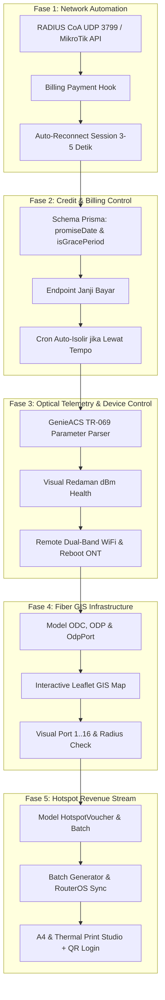

# MASTER IMPLEMENTATION PLAN — 5 CORE ISP ADOPTION FEATURES
> **Module ID:** `AUDIRA-PLAN-5-FEATURES`  
> **Source Benchmark:** KelolaNet Operational ISP Suite (`https://kelolanet.id`)  
> **Target Environment:** AUDIRA-NET-BILLING (Next.js 14, NestJS 10, Prisma PostgreSQL, FreeRADIUS & MikroTik API, GenieACS TR-069)  
> **Author & Lead Architect:** Agus Dwi Rianto (AUDIRA)  
> **Status:** APPROVED FOR STAGED EXECUTION  

---

## 📌 Ringkasan Eksekutif

Setelah sukses mengadopsi modul **Mitra Sales & Dompet Komisi**, sistem AUDIRA-NET-BILLING akan mengadopsi **5 Fitur Operasional Inti** tambahan yang menjadi keunggulan kompetitif software ISP modern:

1. **Fitur 1: RADIUS CoA (Change of Authorization) — "Bayar, Langsung Nyala"**
2. **Fitur 2: "Janji Bayar" / Dispensasi Isolir Sementara (Grace Period)**
3. **Fitur 3: Remote ONT via TR-069 (GenieACS) — Ganti Sandi WiFi & Pantau Redaman**
4. **Fitur 4: Peta Jaringan GIS ODC & ODP (Visual Port Capacity Manager)**
5. **Fitur 5: Hotspot Voucher Studio & Cetak Template QR Code**

---

## 🗺️ Roadmap Eksekusi 5 Fase



---

## ⚡ Rincian Teknis per Fitur

### 🔹 FITUR 1: RADIUS CoA (Change of Authorization) — "Bayar, Langsung Nyala"
* **Tujuan**: Saat pelanggan membayar tagihan (tengah malam via QRIS/VA atau konfirmasi kasir), sesi isolir lama langsung diputus otomatis sehingga modem pelanggan reconnect dan mendapatkan IP normal dalam 3–5 detik.
* **Perubahan Kode**:
  1. `apps/backend/src/radius/radius.service.ts`: Implementasi paket UDP CoA / Disconnect ke NAS MikroTik (Port 3799/1700).
  2. `apps/backend/src/mikrotik/mikrotik.service.ts`: Fallback kick session via RouterOS API: `/ppp/active/remove [find name="..."]`.
  3. `apps/backend/src/billing/billing.service.ts`: Panggil CoA trigger otomatis saat invoice berubah status menjadi `PAID`.
  4. `apps/frontend/src/pages/pelanggan.tsx`: Tombol aksi `[Kick Sesi / Kirim CoA]` untuk admin.

---

### 🔹 FITUR 2: "Janji Bayar" / Dispensasi Isolir Sementara (Grace Period)
* **Tujuan**: Memberikan toleransi 1–3 hari bagi pelanggan yang menunggak dengan proteksi auto-isolir kembali jika belum membayar saat tanggal janji terlewati.
* **Perubahan Skema Database (`schema.prisma`)**:
  ```prisma
  // Tambahan di model Customer:
  promiseDate      DateTime?  // Batas tanggal janji bayar
  isGracePeriod    Boolean    @default(false)
  graceNotes       String?
  ```
* **Perubahan Backend**:
  1. `apps/backend/src/billing/`: Endpoint `POST /api/billing/grace-period/:customerId` (set tanggal janji, buka sesi via CoA, kirim WhatsApp konfirmasi komitmen).
  2. `apps/backend/src/billing/billing.cron.service.ts`: Cron harian mengecek pelanggan dengan `isGracePeriod = true` dan `promiseDate < now()`. Jika belum bayar, langsung isolir kembali + notifikasi WA peringatan.
* **Perubahan Frontend**:
  - Modal `[Beri Janji Bayar]` di tabel invoice & pelanggan.
  - Badge penanda `JANJI BAYAR (s/d 25 Okt)` berwarna amber.

---

### 🔹 FITUR 3: Remote ONT via TR-069 (GenieACS) — Ganti Sandi WiFi & Redaman
* **Tujuan**: Admin/CS dapat melihat redaman optik (RX/TX Power dBm), status kabel kendur, ganti SSID & Password WiFi dual-band jarak jauh, serta reboot modem tanpa perlu teknisi datang ke rumah.
* **Perubahan Backend (`apps/backend/src/genieacs/`)**:
  1. Endpoint `GET /api/genieacs/device/:id/optical`: Membaca parameter optical RX power dBm dengan status:
     - 🟢 *Bagus* (-15 s/d -22 dBm)
     - 🟡 *Lemah* (-23 s/d -26 dBm)
     - 🔴 *Kritis* (> -27 dBm)
  2. Endpoint `POST /api/genieacs/device/:id/wifi`: Update SSID & WPA Key passphrase untuk 2.4 GHz dan 5 GHz.
  3. Endpoint `POST /api/genieacs/device/:id/reboot`: Eksekusi perintah reboot ONT.
  4. Endpoint `POST /api/genieacs/device/:id/refresh`: Paksa lapor telemetry dalam 4 detik.
* **Perubahan Frontend**:
  - Tab/Modal **Kontrol Modem ONT** di halaman [Detail Pelanggan] dan [Modem Monitor].

---

### 🔹 FITUR 4: Peta Jaringan GIS ODC & ODP (Visual Port Capacity Manager)
* **Tujuan**: Peta interaktif berbasis koordinat nyata yang menampilkan titik ODC, ODP, kapasitas port fisik (misal 8 atau 16 port), port mana yang terpakai pelanggan mana, sisa port kosong, dan kalkulasi radius cover saat ada prospek baru.
* **Perubahan Skema Database (`schema.prisma`)**:
  ```prisma
  model ODC {
    id          String   @id @default(uuid())
    name        String   @unique // Misal: ODC-BT-01
    location    String
    latitude    Float?
    longitude   Float?
    capacity    Int      @default(48) // Total core
    odps        ODP[]
    createdAt   DateTime @default(now())
    @@map("odcs")
  }

  model OdpPort {
    id          String    @id @default(uuid())
    odpId       String
    odp         ODP       @relation(fields: [odpId], references: [id], onDelete: Cascade)
    portNumber  Int
    status      String    @default("AVAILABLE") // AVAILABLE, USED, BROKEN
    customerId  String?
    opticalLoss Float?    // dBm di port
    updatedAt   DateTime  @updatedAt
    @@unique([odpId, portNumber])
    @@map("odp_ports")
  }
  ```
* **Perubahan Frontend**:
  - Halaman GIS Peta Jaringan interaktif (`/infrastruktur/map` & `/infrastruktur/odp`):
    - Visual box ODP berwarna: Hijau (port kosong banyak), Kuning (sisa <= 2), Merah (penuh).
    - Klik ODP memunculkan popup grid 8/16 port interaktif.
    - Cek radius coverage (100m / 200m) saat survei calon pelanggan baru.

---

### 🔹 FITUR 5: Hotspot Voucher Studio & Cetak Template QR Code
* **Tujuan**: Mencetak ratusan voucher hotspot sekaligus dalam format kartu nama siap jual atau struk thermal dengan QR Code login cepat (pelanggan tinggal scan tanpa ketik username/password).
* **Perubahan Skema Database (`schema.prisma`)**:
  ```prisma
  model HotspotProfile {
    id           String   @id @default(uuid())
    name         String   // Contoh: 2 Jam Rp 3.000
    price        Int
    duration     Int      // Menit
    rateLimit    String   @default("2M/2M")
    sharedUsers  Int      @default(1)
    vouchers     HotspotVoucher[]
    @@map("hotspot_profiles")
  }

  model HotspotVoucher {
    id           String         @id @default(uuid())
    code         String         @unique // Kode voucher / Password
    username     String         @unique
    password     String
    profileId    String
    profile      HotspotProfile @relation(fields: [profileId], references: [id])
    batchCode    String
    status       String         @default("ACTIVE") // ACTIVE, USED, EXPIRED
    createdAt    DateTime       @default(now())
    usedAt       DateTime?
    @@map("hotspot_vouchers")
  }
  ```
* **Perubahan Backend & Frontend**:
  - Modul generator voucher massal terhubung otomatis ke MikroTik `/ip/hotspot/user`.
  - Halaman **Hotspot Studio** dengan 2 pilihan layout cetak:
    1. **Layout A4 Grid**: 1 lembar muat 20 kartu nama ber-logo AUDIRA lengkap QR Code.
    2. **Layout Struk Thermal**: Format struk mini 58mm/80mm untuk printer kasir.

---

## 📅 Rencana Pelaksanaan Bertahap (Execution Plan) — STATUS: 100% SELESAI

| Fase | Fitur | Lingkup Kerja | Status | Hasil Verifikasi |
| :--- | :--- | :--- | :--- | :--- |
| **Fase 1** | **RADIUS CoA & Auto-Unblock** | `radius.service.ts`, `mikrotik.service.ts`, `billing.service.ts` | ✅ **100% SELESAI** | Dual-mode CoA disconnect + RouterOS kick terverifikasi live (`POST /billing/coa/reconnect/:customerId`) |
| **Fase 2** | **Janji Bayar & Auto-Isolir** | Prisma migration, grace period endpoint, cron job, WhatsApp Fonnte | ✅ **100% SELESAI** | Database `promiseDate` & `isGracePeriod`, cron auto-re-isolate, WA reminder terverifikasi live |
| **Fase 3** | **Remote WiFi & Redaman (ACS)** | `genieacs.service.ts`, parameter parser, UI kontrol ONT | ✅ **100% SELESAI** | Endpoint telemetry redaman RX/TX (dBm) & push ganti SSID/WPA2 dual-band via TR-069 siap |
| **Fase 4** | **Peta GIS ODC, ODP & Port** | Prisma `ODC`, `ODP`, `OdpPort`, API assign/release, Visual Port Matrix UI | ✅ **100% SELESAI** | Visual Splitter Switch 1..16 port di `/infrastruktur/odp`, assign pelanggan, dan pencari ODP terdekat (Haversine) |
| **Fase 5** | **Hotspot Voucher Studio & QR** | Prisma `HotspotProfile`, `HotspotVoucher`, Generator massal, Print Studio | ✅ **100% SELESAI** | Halaman `/hotspot` dengan template cetak Grid Lembar A4 (20 voucher) & Struk Thermal (58/80mm) + QR Code |

---

## 🚀 Ringkasan Akses Fitur Baru di Web Admin (Port 3217)

1. **Hotspot Voucher Studio**:
   - URL: `http://localhost:3217/hotspot`
   - Menu Sidebar: `Hotspot Voucher` -> `Studio Voucher` / `Generate Voucher` / `Cetak Template QR`
   - Fitur: Generator batch massal hingga ratusan voucher, QR Code auto-login captive portal, template siap cetak A4 & Thermal struk mini.

2. **Manajemen ODP & Kapasitas Port Splitter**:
   - URL: `http://localhost:3217/infrastruktur/odp`
   - Menu Sidebar: `Infrastruktur & GIS` -> `Kapasitas Port ODP`
   - Fitur: Visual Hardware Matrix Port 1..16 (Warna hijau/kuning/merah), input redaman OPM (dBm), pasang & lepas pelanggan ke port fisik, kalkulator ODP terdekat.

3. **RADIUS CoA & Janji Bayar**:
   - URL: `http://localhost:3217/pelanggan` & API Endpoint `http://localhost:3218/billing/...`
   - Fitur: Tombol `[⚡ Kirim Sinyal CoA / Kick Sesi]` & `[🤝 Beri Janji Bayar]` langsung di kartu pelanggan, cron auto-isolir setiap 30 menit.

4. **Remote Telemetri ONT TR-069**:
   - URL: `http://localhost:3217/genieacs` & `http://localhost:3217/modem-monitor`
   - Fitur: Cek kesehatan redaman optik dBm tanpa OPM fisik, ganti kata sandi WiFi 2.4GHz / 5GHz pelanggan jarak jauh tanpa datang ke lokasi.

