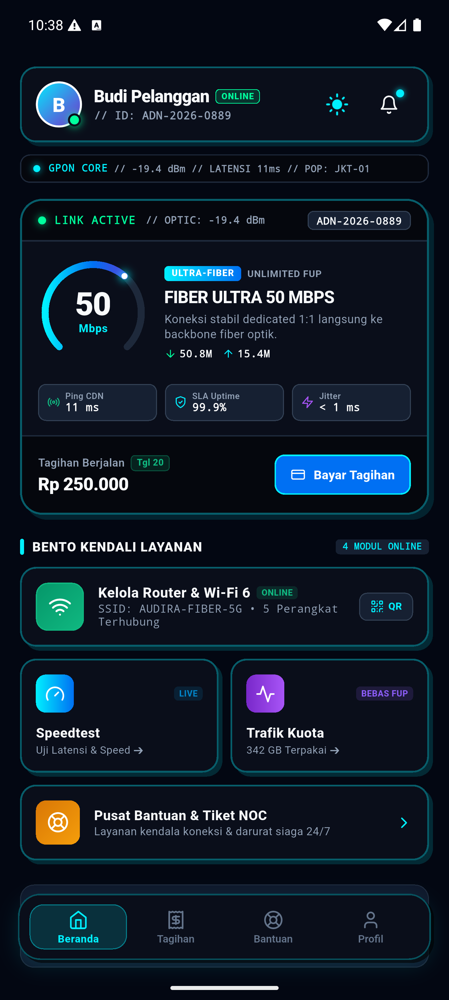
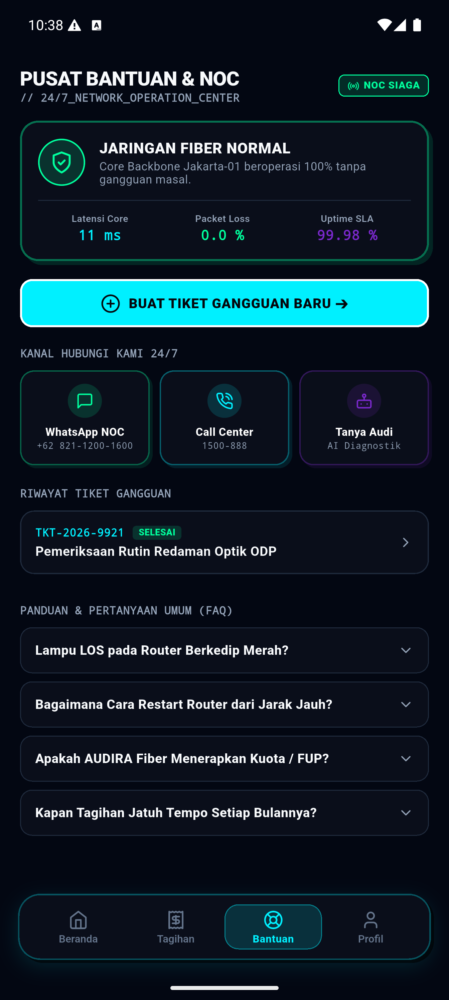
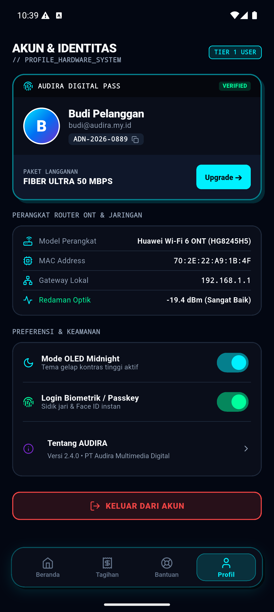
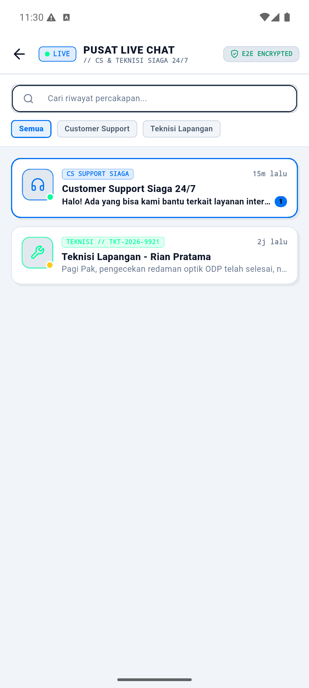
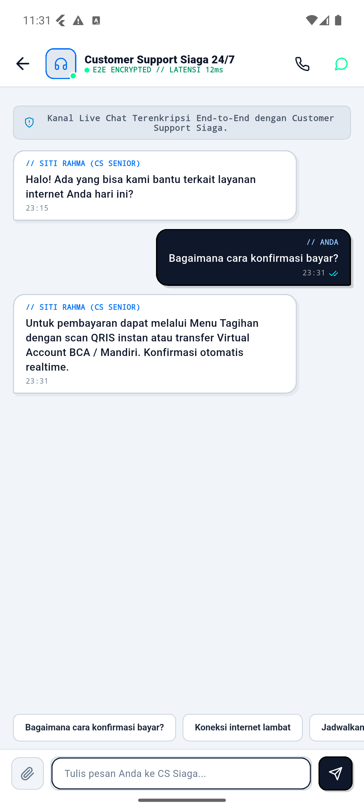
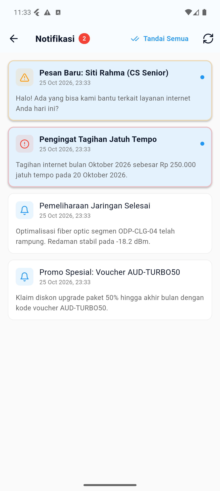

# 📸 AUDIRA NET — UI/UX Showcase Gallery
### Neo-Brutalism + Cyberpunk Studio Design System

Dokumentasi visual representasi antarmuka aplikasi **AUDIRA-NET** berbasis standar desain:
- **Design Language**: *Neo-Brutalism + Cyberpunk Studio*
- **Canvas Base**: *Deep Midnight OLED* (`#05070D` & `#0A0E1A`)
- **Neon Tokens**: Electric Cyan (`#00F0FF`), Signal Blue (`#0070F3`), Neon Green (`#00FF9D`), Vivid Purple (`#7928CA`)
- **Component Geometry**: Bento Box Modular Grids, Hard Tactile Drop Shadows (`offset: Offset(4, 4)`, `blurRadius: 0`), 1.8px - 2px Cyber Borders, and Floating Capsule Dock.

---

## 📑 Daftar Tangkapan Layar (Screenshots Index)

| No | Tampilan | Berkas | Resolusi | Deskripsi |
| :---: | :--- | :--- | :---: | :--- |
| **01** | Unified Cyber Login | [`01_login_cyberpunk_dark.png`](./01_login_cyberpunk_dark.png) | 1344 x 2992 | Multi-role selector (Pelanggan / Teknisi / Admin), glowing halo logo, Passkey auth |
| **02** | Customer Beranda (HUD) | [`02_customer_beranda_hud.png`](./02_customer_beranda_hud.png) | 1344 x 2992 | Cyber Command HUD Header, Speedometer Arc Gauge, Live RX/TX, Bento service cards |
| **03** | Customer Tagihan (Bento) | [`03_customer_tagihan_bento.png`](./03_customer_tagihan_bento.png) | 1344 x 2992 | Invoicing bento, itemized breakdown, QRIS & Virtual Account rails, invoice ledger |
| **04** | Customer Bantuan (NOC) | [`04_customer_bantuan_noc.png`](./04_customer_bantuan_noc.png) | 1344 x 2992 | NOC Network Health telemetry, Live Chat banner, direct ticket technician chat, FAQ |
| **05** | Customer Profil & Hardware | [`05_customer_profil_hardware.png`](./05_customer_profil_hardware.png) | 1344 x 2992 | Verified digital pass, ONT Wi-Fi 6 hardware specs, optic attenuation, OLED switches |
| **06** | Logout Confirmation Modal | [`06_customer_logout_dialog.png`](./06_customer_logout_dialog.png) | 1344 x 2992 | Neo-brutalist security confirmation modal with high-contrast red accent |
| **07** | Customer Beranda (Light Mode) | [`07_customer_beranda_light.png`](./07_customer_beranda_light.png) | 1344 x 2992 | High-contrast Neo-Brutalism daytime layout with bold borders & tactical typography |
| **08** | Teknisi Field Ops Dashboard | [`08_teknisi_dashboard_capsule.png`](./08_teknisi_dashboard_capsule.png) | 1344 x 2992 | Floating Cyber-Capsule Dock, GPS selfie check-in, real-time dispatch telemetry |
| **09** | Teknisi Profil & Kinerja | [`09_teknisi_profil_dark.png`](./09_teknisi_profil_dark.png) | 1344 x 2992 | KPI performance cards (Selesai, Instalasi, Rating, Response Time), utility controls |
| **10** | Pusat Live Chat Center | [`10_live_chat_center.png`](./10_live_chat_center.png) | 1344 x 2992 | Multi-channel inbox (CS Siaga & Teknisi Lapangan), unread badge, filter & search |
| **11** | Live Chat CS Dialogue | [`11_live_chat_cs_dialogue.png`](./11_live_chat_cs_dialogue.png) | 1344 x 2992 | Two-way instant chat with CS Senior, quick response chips, encrypted E2E badge |
| **12** | Live Chat Teknisi Lapangan | [`12_live_chat_teknisi_field.png`](./12_live_chat_teknisi_field.png) | 1344 x 2992 | Direct field ticket chat with technician, live ETA & optical attenuation updates |
| **13** | Push Notification Center | [`13_push_notifications_center.png`](./13_push_notifications_center.png) | 1344 x 2992 | Scheduled billing reminders, chat alerts, maintenance logs, and promo voucher alerts |

---

## 🖼️ Galeri Visual Lengkap

### 1. Unified Cyber Login & Passkey Authentication
Autentikasi terpadu 3-in-1 untuk Pelanggan, Teknisi Lapangan, dan Admin/NOC. Dilengkapi indikator telemetri gateway real-time dan login cepat biometrik.

  

---

### 2. Customer Beranda — Cyber Command HUD & Arc Gauge
Pusat kendali pelanggan dengan Speedometer Arc dinamis, pemantauan trafik unduh/unggah langsung, telemetry ribbon GPON Core, serta tombol aksi cepat Bento.

  

---

### 3. Customer Tagihan — Bento Invoicing & Payment Rails
Manajemen tagihan transparan dengan rincian biaya itemized, status jatuh tempo, integrasi QRIS Instan, BCA VA, Mandiri VA, dan e-wallet.

  

---

### 4. Customer Bantuan — NOC Incident Support & 24/7 Hotline
Pusat kendali insiden dan bantuan 24/7 terhubung langsung ke Live Chat CS Siaga & Teknisi Lapangan, hotline WhatsApp resmi (`+62 821-1200-1600`), Call Center 1500-888, AI Assistant *"Tanya Audi"*, dan FAQ interaktif.

  

---

### 5. Customer Profil & ONT Hardware Diagnostics
Identitas pelanggan terverifikasi, nomor ID pelanggan monospace, spesifikasi ONT Hardware (ZTE F670L Wi-Fi 6), pemantauan redaman optik (-19.4 dBm Normal), dan switch OLED.

  

---

### 6. Modal Konfirmasi Logout Neo-Brutalist
Dialog konfirmasi keluar sesi dengan penekanan kontras tinggi dan pengaman pembatalan instan.

  

---

### 7. Customer Beranda — Light Mode Neo-Brutalism
Mode terang kontras tinggi untuk kenyamanan penggunaan di bawah sinar matahari langsung dengan aksen border tegas dan bayangan keras.

  

---

### 8. Teknisi Field Operations Dashboard — Floating Cyber-Capsule Dock
Dashboard operasional lapangan dengan Floating Capsule Dock (Tugas, Absen, Peta, Profil), GPS selfie check-in, dan daftar tiket penugasan real-time.

  

---

### 9. Teknisi Profil & Evaluasi Kinerja (KPI)
Laporan performa teknisi lengkap (Tiket Selesai, Instalasi Baru, Rating Pelanggan, Waktu Respon), utilitas diagnostik barcode scanner & inventori alat kerja.

  

---

### 10. Pusat Live Chat Real-Time (CS Siaga & Teknisi)
Pusat komunikasi real-time dua arah yang memisahkan kanal Customer Support 24/7 dan Teknisi Lapangan dengan enkripsi E2E, badge unread pesan, dan pencarian instan.

  

---

### 11. Live Chat CS Dialogue — Real-time Support
Percakapan langsung dengan CS Senior dengan gelembung pesan Neo-Brutalist, centang status pengiriman (`✓✓`), dan tombol respon cepat (Quick Chips).

  

---

### 12. Live Chat Teknisi Lapangan — Tiket Kendala ODP
Komunikasi koordinasi langsung antara pelanggan dan teknisi penanganan tiket, menampilkan estimasi waktu tiba (ETA) dan status redaman optik lapangan secara akurat.

  

---

### 13. Push Notification & Alert Center
Pusat notifikasi otomatis mencakup pengingat tagihan jatuh tempo, notifikasi chat masuk, notifikasi perbaikan jaringan fiber, dan kode voucher promo loyalitas.

  

---

## 🏛️ Copyright & Attribution
© 2026 **Agus Dwi Rianto (AUDIRA)**. All Rights Reserved.  
Dikembangkan oleh **Audira Multimedia Digital / Audira Sukses Mandiri**.  
Situs Resmi: [https://audira.my.id](https://audira.my.id)
